# Relacion de Ejercicios De Binario Y De Puerta Logicas

> @autor: Sheila mm
> Fecha: 5-octubre-26

## Relacion 20

### Ejercicio 1
- Apartado A: Solución $117,4(10) $\rightarrow$ $101010,101_{(2)}$ (poner la base en la que está)
- Apartado B: Solución $225,375(10)
 - 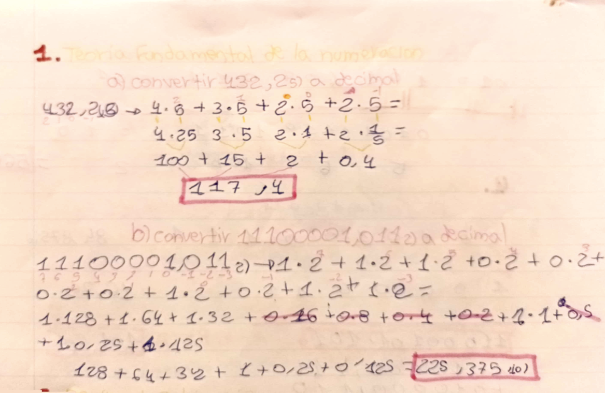
---

### Ejercicio 2
- Apartado A: Solución binario $100010011011(2), octal $211,54(8), hexadecimal $89b(16)
- Apartado B: Solución $27,1 010111,001 (no es exacto)
 - 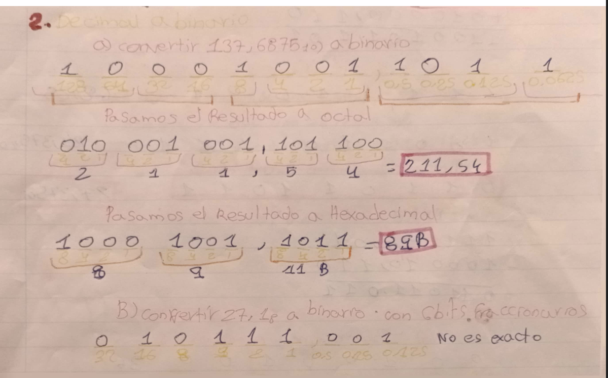
---

### Ejercicio 3
- Apartado A: Solución $4516,44_(8)
- Apartado B: Solución $56b,2_(16)
  - 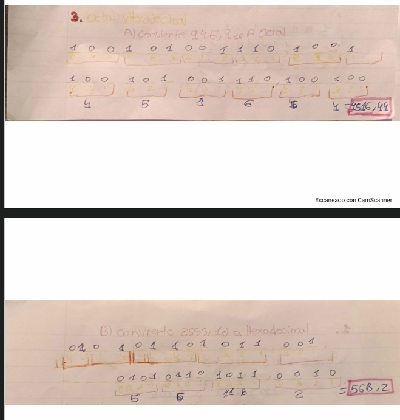

---

### Ejercicio 4
- Apartado A: Solución $1100101,101$
- Apartado B: Solución $011011,011$
  - 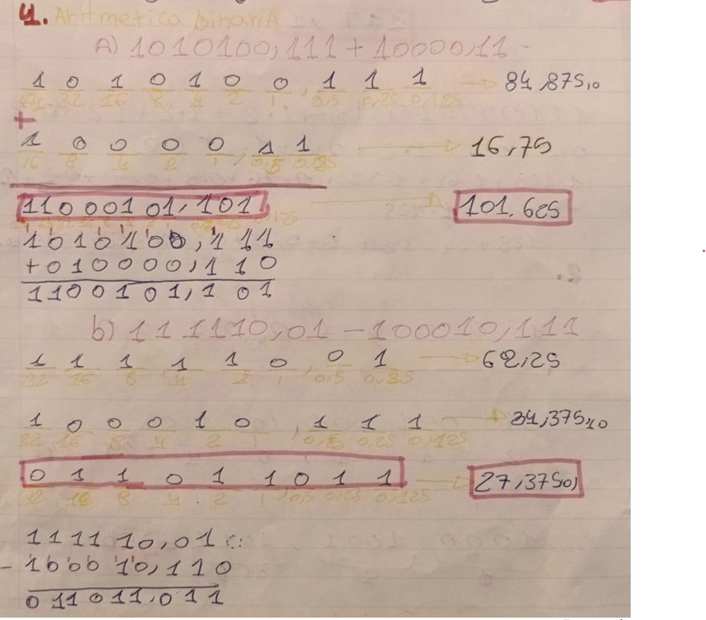

---

### Ejercicio 5
- Apartado A: Solución 11011100
  - 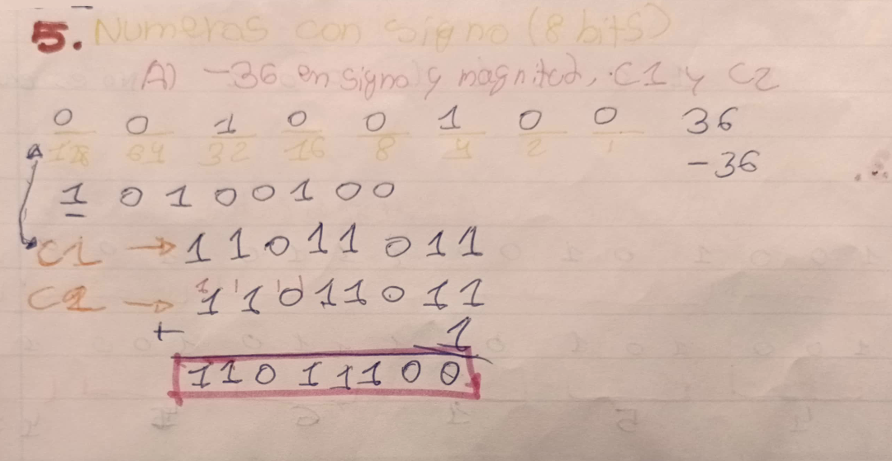
- Apartado B: Solución $00010111 = 23_(10)
  - 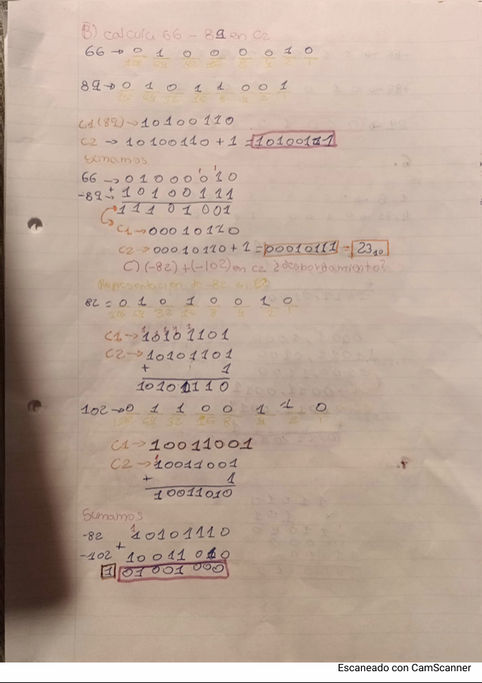
- **Apartado C:** $(-82) + (-102) en C2 (¿Desbordamiento?)
  - 
- **Apartado D:** En signo y magnitud $(-66) + (89)$ $\rightarrow$ Solución $24 = 00010111$
  - 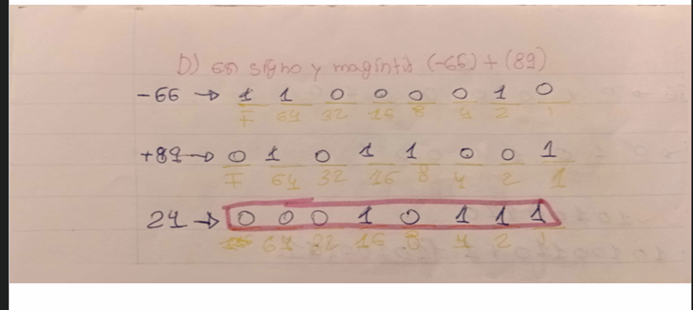

---

### Ejercicio 6
- **Coma fija:** $1,5 - 4,75$ en 8 bits en C2.
  - Solución: $0011,0400 = 3,25$
  - 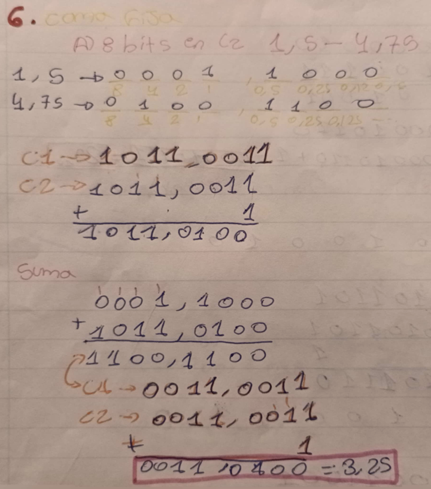

---

### Ejercicio 7
- Apartado A: Multiplicar en binario $11010 \times 101$ $\rightarrow$ Solución $1000010 = 38,25$
  - 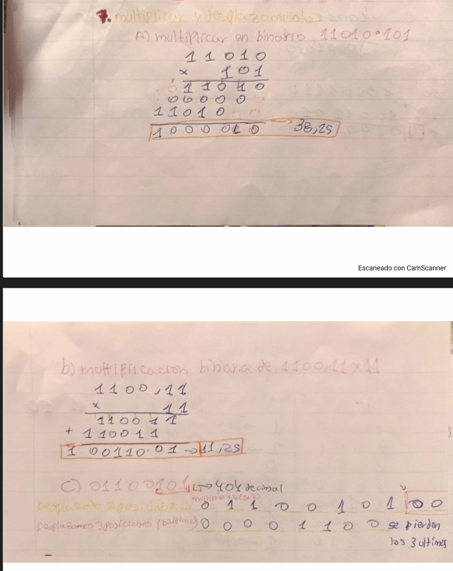
- Apartado B: Multiplicación binaria de $1100,11 \times 11$ $\rightarrow$ Solución $100110,01 = 11,25$
  - 
- Apartado C: Desplazamientos
  - 

---

### Ejercicio 8
- **Unidades:** Imagen $1920 \times 1080$ a 24 bits por píxel.
  - Total de píxeles: $1920 \times 1080 = 2.073.600$ píxeles
  - Bytes por píxel: $24 / 8 = 3$
  - Tamaño en bytes: $2.073.600 \times 3 = 6.220.800$ bytes
  - Conversión a MB y MiB:
    - Megabytes (MB): $6.220.800 / 1.000.000 = 6,2208 \text{ MB}$
    - Mebibytes (MiB): $6.220.800 / 1.048.576 = 5,9326 \text{ MiB}$
  - ¿Cuántas imágenes caben en 32 GB? $32.000.000.000 / 6.220.800 = 5.144 \text{ imágenes}$
  - 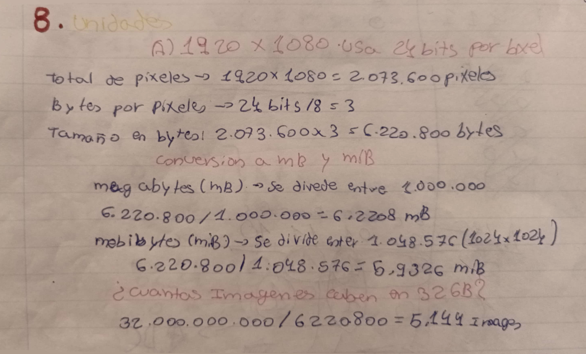

---

### Ejercicio 9
- Análisis de un circuito (Tabla de verdad y conexiones lógicas XOR/NOR)

- Expresión lógica: $S = (A \oplus B) \oplus \overline{(B + C)}$

- Tabla de Verdad:

| A | B | C | XOR ($A \oplus B$) | NOR ($\overline{B+C}$) | Salida ($S$) |
------------------------------------------------------------------------
| 0 | 0 | 0 | 0 | 1 | 1 |
| 0 | 0 | 1 | 0 | 0 | 0 |
| 0 | 1 | 0 | 1 | 0 | 1 |
| 0 | 1 | 1 | 1 | 0 | 1 |
| 1 | 0 | 0 | 1 | 1 | 0 |
| 1 | 0 | 1 | 1 | 0 | 1 |
| 1 | 1 | 0 | 0 | 0 | 0 |
| 1 | 1 | 1 | 0 | 0 | 0 |

---
- 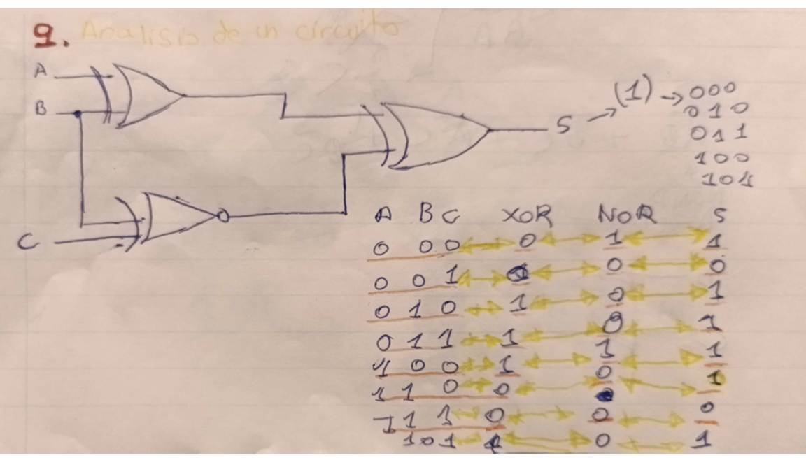

---

### Ejercicio 10
- **Diseño y simplificación** (Mapa de Karnaugh y esquema de puertas lógicas)
- 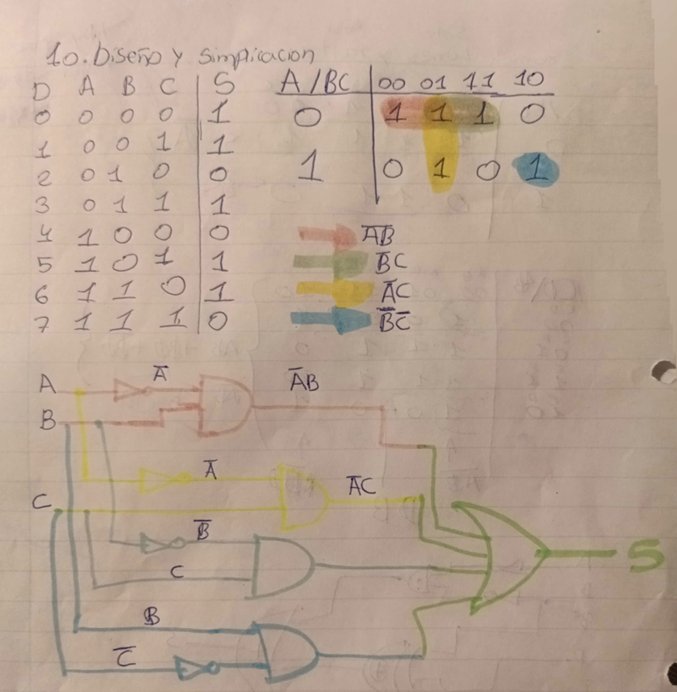
# Relacion de Ejercicios De Binario Y De Puerta Logicas
## 10. Diseño y Simplificación de Circuitos

- Tabla de Verdad y Mapa de Karnaugh:

| Dec | A | B | C | S |
------------------------
| 0 | 0 | 0 | 0 | 1 |
| 1 | 0 | 0 | 1 | 1 |
| 2 | 0 | 1 | 0 | 0 |
| 3 | 0 | 1 | 1 | 1 |
| 4 | 1 | 0 | 0 | 0 |
| 5 | 1 | 0 | 1 | 1 |
| 6 | 1 | 1 | 0 | 1 |
| 7 | 1 | 1 | 1 | 0 |

